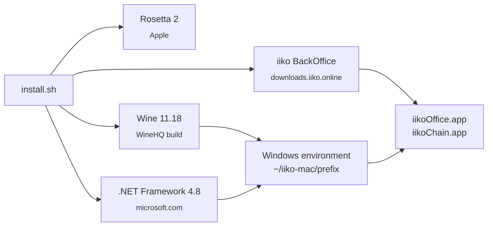

<p align="center">
  
</p>

<p align="center">
  <a href="README.md">Русский</a> · <b>English</b>
</p>

<p align="center">
  
  
  
  
  
</p>

<h3 align="center">iikoOffice and iikoChain were never built for Mac.<br>This runs them anyway.</h3>

---

```bash
zsh -c "$(curl -fsSL https://raw.githubusercontent.com/azamoviich/iiko-mac/main/install.sh)"
```

Paste into **Terminal**. Type your iiko version. Pick iikoOffice, iikoChain or both. Go make coffee.

When it says `Готово`, open `~/Applications` and launch **iikoOffice** or **iikoChain** like any other Mac app.

## Why

The only "official" way to use iiko BackOffice on a Mac is a Windows virtual machine: a paid Parallels licence, a Windows licence, 50–70 GB of disk, and a second operating system eating your RAM just to open one window.

`iiko-mac` runs the **original, unmodified** BackOffice directly on macOS through [Wine](https://www.winehq.org/), a compatibility layer rather than an emulator. No Windows install. No VM.

| | Windows VM | **iiko-mac** |
|---|---|---|
| Disk | 50–70 GB | **~3 GB** one app, **~4 GB** both |
| RAM | a whole second OS | only what iiko uses |
| Cost | Parallels + Windows licences | **free** |
| Setup | an afternoon | **one command, 10–20 min** |
| Windows updates | yes, sadly | never |

## What you get

- **The real app.** Same binaries iiko ships for Windows, straight from iiko's own download server. Any version: you type it, the installer fetches it.
- **Feels like a Mac app.** <kbd>⌘C</kbd> <kbd>⌘V</kbd> <kbd>⌘A</kbd> <kbd>⌘Z</kbd> work. Real `.app` bundles you can drag to the Dock.
- **Excel export just works.** Reports open in your Mac's Excel or Numbers; PDFs open in Preview.
- **Zero dependencies.** No Homebrew, no Xcode, no Python. Only what macOS already has.
- **Clean.** Everything lives in `~/iiko-mac`. One script removes it all.

## Install

**One line** (recommended):

```bash
zsh -c "$(curl -fsSL https://raw.githubusercontent.com/azamoviich/iiko-mac/main/install.sh)"
```

**Or without prompts:**

```bash
curl -fsSLO https://raw.githubusercontent.com/azamoviich/iiko-mac/main/install.sh
zsh install.sh 9.2.7014.0 both     # office | chain | both
```

> [!IMPORTANT]
> Your BackOffice version must match your iiko server **exactly** or the server refuses the login. Ask your iiko admin, or check the version shown by an already-working BackOffice.

**First login:** installer messages are in Russian. In the login window press **Дополнительно >>**, enter your server address and port, then your login and password.

**Server got updated?** Run the installer again with the new version. Wine and .NET are kept; only the iiko files are fetched again.

**Uninstall:**

```bash
zsh -c "$(curl -fsSL https://raw.githubusercontent.com/azamoviich/iiko-mac/main/uninstall.sh)"
```

## How it works



BackOffice is a WinForms + DevExpress application on .NET Framework 4.7.2. Getting it to boot on macOS meant getting past five walls:

<details>
<summary><b>1. Wine's built-in .NET (Mono) crashes DevExpress</b></summary>

<br>

Out of the box Wine runs .NET programs on Mono. BackOffice starts, then dies while measuring text for its very first label:

```
System.NullReferenceException
  at DevExpress.Utils.Text.FontsCache.GetFontCacheByFont(Graphics, Font)
```

DevExpress reaches into Microsoft-only font internals that Mono does not have. The fix is the real Microsoft runtime.
</details>

<details>
<summary><b>2. The standard .NET install path hangs</b></summary>

<br>

The usual recipe (`winetricks dotnet48`) installs .NET 4.0 first and that installer hangs forever at 0% CPU on current macOS Wine builds. `iiko-mac` skips it and runs the .NET 4.8 offline installer directly.
</details>

<details>
<summary><b>3. .NET 4.8 installs, and Wine still uses Mono</b></summary>

<br>

The sneaky one. With 4.8 fully installed, BackOffice still failed with `Mono.SystemDependencyProvider` in the stack trace. On Windows 7 and later, `mscoree.dll` (the loader that decides which runtime starts a .NET program) is an OS component, so the 4.8 installer never writes it. Wine's stub stays in `system32` and keeps routing everything to Mono.

`iiko-mac` pulls Microsoft's `mscoree.dll` out of the .NET 4.0 package and drops it in by hand. BackOffice then boots on the real CLR.
</details>

<details>
<summary><b>4. Unpacking the installer without any tools</b></summary>

<br>

iiko's setup is a WiX Burn bundle: a PE stub with two cabinet archives glued on the end. Most guides reach for 7-Zip here. To keep the installer dependency-free it instead finds the cabinets by their `MSCF` headers, carves them out with `tail`/`head`, extracts them with Wine's own `extrac32`, reads the bundle manifest to map payload ids to real file names, and unpacks the MSI with `msiexec /a`.
</details>

<details>
<summary><b>5. Wine crashes when the Mac has more than three DNS servers</b></summary>

<br>

It worked on one Mac and crashed inside `iphlpapi` on another, right after opening the server settings. The crash dump had `02 00 00 00 08 08 08 08` where a pointer should be: the DNS server address `8.8.8.8`. Wine's `GetAdaptersAddresses` never initialises the size of its DNS list buffer, so with four or more servers the list overruns the stack. The bug is present in every current Wine release.

The installer writes the missing instruction straight into `iphlpapi.dll`: 33 bytes, only for the build with a known checksum, with the original kept alongside as `.orig`.
</details>

Two more touches make it livable: Wine's `Mac Driver` is told to treat <kbd>⌘</kbd> as <kbd>Ctrl</kbd>, and common document types (`xlsx`, `pdf`, `docx`, …) are registered to hand off to macOS `open`, so exports land in your Mac apps instead of a "no application associated" error.

## Tested

Honest status. This is young.

| | |
|---|---|
| ✅ iikoOffice 9.2.7014.0 | launch, login, reports, Excel export |
| ✅ iikoChain 9.2.7014.0 | launch to login |
| ✅ MacBook, Apple M4, macOS 27 | full clean install of both apps |
| ❔ Other iiko versions | should work; unpacking may differ on old releases |
| ❔ Intel Macs, older macOS | untested |
| ❔ Printing, cash-register hardware, card readers | untested; smart-card drivers are skipped |
| ❔ BackOffice auto-update from the server | untested; re-run the installer instead |

Something broken on your version or Mac? [Open an issue](../../issues/new) with your iiko version, Mac model, macOS version and the `ОШИБКА:` line.

## FAQ

**Is it slow?**
First launch takes 20–40 seconds. After that it is normal desktop-app speed. Intel code runs through Rosetta 2, but this is an office app, not a game.

**Is my data safe?**
BackOffice talks straight to your iiko server, exactly as on Windows. Nothing is proxied, logged or sent anywhere else. Read `install.sh`, it is about 200 lines.

**Where do exported files go?**
`~/iiko-mac/prefix/drive_c/users/<you>/AppData/Local/Temp/Resto/` — and they open automatically.

**Does it need Homebrew / admin rights?**
No. The only system-level step is Apple's Rosetta 2, which macOS installs itself.

**iikoFront (the POS terminal)?**
Not included. It depends on cash-register and payment hardware that needs real Windows drivers.

## Legal

This repository contains **only installer scripts**. It includes no iiko software and no Microsoft software. During installation your Mac downloads each component from its own vendor, under that vendor's licence:

- Wine — [Gcenx/macOS_Wine_builds](https://github.com/Gcenx/macOS_Wine_builds) (LGPL)
- .NET Framework — microsoft.com
- iiko BackOffice — downloads.iiko.online

You need your own iiko licence and server. **Not affiliated with, authorised or endorsed by iiko.** "iiko", "iikoOffice" and "iikoChain" are trademarks of their owner, used here only to describe compatibility. Provided as is, with no warranty. Scripts are [MIT](LICENSE) licensed.
