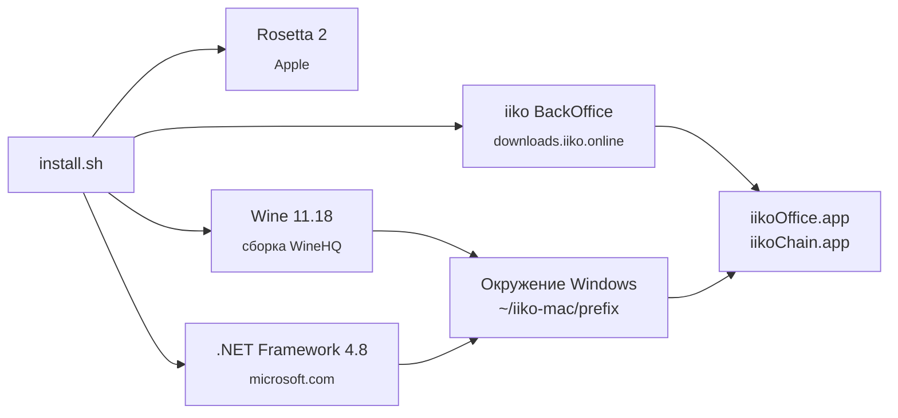

<p align="center">
  
</p>

<p align="center">
  <b>Русский</b> · <a href="README.en.md">English</a>
</p>

<p align="center">
  
  
  
  
  
</p>

<h3 align="center">iikoOffice и iikoChain не делали для Mac.<br>Здесь они всё равно работают.</h3>

---

```bash
zsh -c "$(curl -fsSL https://raw.githubusercontent.com/azamoviich/iiko-mac/main/install.sh)"
```

Вставьте в **Терминал**. Введите версию iiko. Выберите iikoOffice, iikoChain или оба. Идите за кофе.

Когда появится `Готово`, откройте `~/Applications` и запускайте **iikoOffice** или **iikoChain** как обычное приложение Mac.

## iiko на Mac: зачем это нужно

Единственный «официальный» способ работать с iiko BackOffice на Mac (MacBook, iMac, Mac mini) — виртуальная машина с Windows: платный Parallels, лицензия Windows, 50–70 ГБ диска и вторая операционная система в памяти ради одного окна.

`iiko-mac` запускает **оригинальный, неизменённый** BackOffice прямо в macOS через [Wine](https://www.winehq.org/) — это слой совместимости, а не эмулятор. Без установки Windows. Без виртуальной машины.

| | Виртуальная машина | **iiko-mac** |
|---|---|---|
| Диск | 50–70 ГБ | **~3 ГБ** одно приложение, **~4 ГБ** оба |
| Память | целая вторая ОС | только сам iiko |
| Цена | Parallels + Windows | **бесплатно** |
| Установка | полдня | **одна команда, 10–20 минут** |
| Обновления Windows | да, увы | никогда |

## Что вы получаете

- **Настоящее приложение.** Те же файлы, что iiko выпускает для Windows, с сервера самого iiko. Любая версия: вводите номер — установщик скачивает.
- **Ведёт себя как Mac-приложение.** <kbd>⌘C</kbd> <kbd>⌘V</kbd> <kbd>⌘A</kbd> <kbd>⌘Z</kbd> работают. Обычные `.app`, которые можно перетащить в Dock.
- **Экспорт в Excel работает.** Отчёты открываются в Excel или Numbers на Mac, PDF — в «Просмотре».
- **Ничего не нужно ставить заранее.** Ни Homebrew, ни Xcode, ни Python. Только то, что уже есть в macOS.
- **Чисто.** Всё лежит в `~/iiko-mac`. Удаляется одной командой.

## Установка

1. Откройте **Терминал** (<kbd>⌘</kbd>+<kbd>Пробел</kbd> → `Терминал` → <kbd>Enter</kbd>).
2. Вставьте команду и нажмите <kbd>Enter</kbd>:

   ```bash
   zsh -c "$(curl -fsSL https://raw.githubusercontent.com/azamoviich/iiko-mac/main/install.sh)"
   ```
3. Введите версию iiko, например `9.2.7014.0`.
4. Выберите: `1` iikoOffice, `2` iikoChain, `3` оба.
5. Ждите строку `Готово`. Терминал не закрывайте. Установка .NET идёт несколько минут без вывода — это нормально.

> [!IMPORTANT]
> Версия BackOffice должна **точно** совпадать с версией вашего сервера iiko, иначе сервер не пустит. Уточните у администратора iiko или посмотрите версию в уже работающем BackOffice.

**Без вопросов, одной строкой:**

```bash
curl -fsSLO https://raw.githubusercontent.com/azamoviich/iiko-mac/main/install.sh
zsh install.sh 9.2.7014.0 both     # office | chain | both
```

## Как запускать

- **Finder** → <kbd>⌘</kbd><kbd>⇧</kbd><kbd>G</kbd> → введите `~/Applications` → двойной щелчок по **iikoOffice** или **iikoChain**.
- Или **Spotlight**: <kbd>⌘</kbd>+<kbd>Пробел</kbd> → `iikoOffice` → <kbd>Enter</kbd>.
- Перетащите значок в **Dock**, чтобы он всегда был под рукой.

Первый запуск занимает 20–40 секунд. В окне входа нажмите **Дополнительно >>**, введите адрес и порт сервера, затем логин и пароль. Адрес сохранится.

**Сервер обновили?** Запустите установщик ещё раз с новой версией. Wine и .NET останутся, скачаются только файлы iiko.

**Удаление:**

```bash
zsh -c "$(curl -fsSL https://raw.githubusercontent.com/azamoviich/iiko-mac/main/uninstall.sh)"
```

## Как это устроено



BackOffice — приложение на WinForms + DevExpress под .NET Framework 4.7.2. Чтобы оно запустилось на macOS, пришлось пробить четыре стены:

<details>
<summary><b>1. Встроенный в Wine .NET (Mono) роняет DevExpress</b></summary>

<br>

По умолчанию Wine запускает .NET-программы на Mono. BackOffice стартует и падает, измеряя текст для самой первой надписи:

```
System.NullReferenceException
  at DevExpress.Utils.Text.FontsCache.GetFontCacheByFont(Graphics, Font)
```

DevExpress обращается к внутренностям шрифтов, которые есть только у Microsoft. Решение — настоящая среда выполнения Microsoft.
</details>

<details>
<summary><b>2. Стандартный способ установки .NET зависает</b></summary>

<br>

Обычный рецепт (`winetricks dotnet48`) сначала ставит .NET 4.0, а его установщик на актуальных сборках Wine для macOS висит вечно с 0% CPU. `iiko-mac` пропускает этот шаг и запускает офлайн-установщик .NET 4.8 напрямую.
</details>

<details>
<summary><b>3. .NET 4.8 установлен, а Wine всё равно использует Mono</b></summary>

<br>

Самая коварная. При полностью установленном 4.8 BackOffice всё ещё падал с `Mono.SystemDependencyProvider` в стеке. В Windows 7 и новее `mscoree.dll` (загрузчик, который решает, какая среда запустит .NET-программу) — часть системы, поэтому установщик 4.8 его не записывает. В `system32` остаётся заглушка Wine и продолжает отправлять всё в Mono.

`iiko-mac` достаёт `mscoree.dll` от Microsoft из пакета .NET 4.0 и кладёт его на место вручную. После этого BackOffice запускается на настоящем CLR.
</details>

<details>
<summary><b>4. Распаковка установщика без сторонних программ</b></summary>

<br>

Установщик iiko — пакет WiX Burn: PE-заглушка, к которой приклеены два cab-архива. Обычно здесь берут 7-Zip. Чтобы не тянуть зависимости, скрипт находит архивы по заголовкам `MSCF`, вырезает их через `tail`/`head`, распаковывает встроенным в Wine `extrac32`, читает манифест пакета, чтобы сопоставить идентификаторы с именами файлов, и разворачивает MSI через `msiexec /a`.
</details>

И ещё две мелочи для удобства: драйверу Wine для Mac сказано считать <kbd>⌘</kbd> клавишей <kbd>Ctrl</kbd>, а типы документов (`xlsx`, `pdf`, `docx`, …) привязаны к системной команде `open`, поэтому выгрузки открываются в приложениях Mac, а не заканчиваются ошибкой «нет связанного приложения».

## Что проверено

Честно: проект молодой.

| | |
|---|---|
| ✅ iikoOffice 9.2.7014.0 | запуск, вход, отчёты, экспорт в Excel |
| ✅ iikoChain 9.2.7014.0 | запуск до окна входа |
| ✅ MacBook, Apple M4, macOS 27 | чистая установка обоих приложений |
| ❔ Другие версии iiko | должны работать; на старых версиях распаковка может отличаться |
| ❔ Mac на Intel, старые macOS | не проверялось |
| ❔ Печать, кассовое оборудование, считыватели карт | не проверялось; драйверы смарт-карт пропускаются |
| ❔ Автообновление BackOffice с сервера | не проверялось; запустите установщик заново |

Не работает на вашей версии или Mac? [Создайте issue](../../issues/new): версия iiko, модель Mac, версия macOS и строка `ОШИБКА:`.

## Вопросы

**Медленно?**
Первый запуск 20–40 секунд. Дальше — обычная скорость настольного приложения. Код для Intel идёт через Rosetta 2, но это офисная программа, а не игра.

**Мои данные в безопасности?**
BackOffice подключается напрямую к вашему серверу iiko, как и на Windows. Ничего не перехватывается, не записывается и никуда не отправляется. `install.sh` — около 200 строк, прочитайте.

**Куда сохраняются выгруженные файлы?**
`~/iiko-mac/prefix/drive_c/users/<вы>/AppData/Local/Temp/Resto/` — и открываются автоматически.

**Нужен Homebrew или права администратора?**
Нет. Единственный системный шаг — Rosetta 2 от Apple, её ставит сама macOS.

**iikoFront (касса)?**
Нет. Ему нужны драйверы кассового и платёжного оборудования под настоящую Windows.

**Айко на макбуке, iikoOffice macOS, iiko для Mac — это оно?**
Да. Это всё про одно и то же: бэк-офис iiko на компьютерах Apple.

## Правовая информация

В репозитории **только скрипты установки**. Здесь нет программ iiko и нет программ Microsoft. При установке ваш Mac сам скачивает каждый компонент у его владельца, на условиях его лицензии:

- Wine — [Gcenx/macOS_Wine_builds](https://github.com/Gcenx/macOS_Wine_builds) (LGPL)
- .NET Framework — microsoft.com
- iiko BackOffice — downloads.iiko.online

Нужны собственная лицензия и сервер iiko. **Проект не связан с iiko, не авторизован и не одобрен ею.** «iiko», «iikoOffice» и «iikoChain» — товарные знаки их владельца, упоминаются только для описания совместимости. Предоставляется как есть, без гарантий. Скрипты распространяются по лицензии [MIT](LICENSE).
